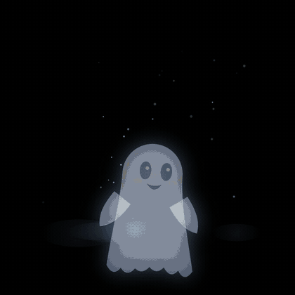

# 👻 Wave-back window ghost

<p align="center"></p>

A cute ghost projected in an upstairs window that **waves back at trick-or-treaters**.
A Ring camera watches the driveway, a pose-detection AI on a Mac spots someone waving,
and the ghost reacts. It greets new arrivals first ("Hiii! Wave at me!") so people know to wave.

Our Halloween night: ~195 greetings, 46 wave-backs. 1 in 15 waves gets the rare **golden ghost** ⭐.

```
Ring camera ──► ring/stream.mjs ──► frames/latest.jpg ──► detector/wave.py (YOLO pose)
                                                              │  someone arrived → /greet
                                                              │  someone waved   → /wave
                                                              ▼
                     projector ◄── browser fullscreen ◄── ghost/server.mjs (+ index.html)
```

Everything runs locally. No video is uploaded anywhere except Ring's own live stream to your computer.

## What you need

**Hardware**
- A **Ring camera** that can see where people stand (we used a high driveway camera). Live view must work in the Ring app.
- A computer that stays on all evening. Built and tested on an **Apple Silicon Mac** (M1 or newer). A Linux/Windows PC with an NVIDIA GPU should work (`DEVICE=cuda`), or plain CPU (`DEVICE=cpu`, slower: lower `--imgsz` to 960 or 640).
- A **projector** pointed at the window from inside the house.
- A **rear-projection surface** taped inside the window: a frosted shower curtain, white plastic sheet, or rear-projection film. It catches the light so the ghost shows from the street.
- Optional: a speaker near the window for the ghost's voice.

**Software**
- [Node.js](https://nodejs.org) 20+
- Python 3.10+
- ffmpeg (`brew install ffmpeg` on Mac)
- Google Chrome (for the fullscreen ghost)

## Setup (one time)

```sh
git clone <this repo> && cd halloween-ghost

# 1) Ring: install and log in (creates ring/token.json, which is ignored by git; keep it private)
cd ring
npm install
npx ring-auth-cli          # asks for your Ring email, password and 2FA code
```

`ring-auth-cli` prints a **refresh token**. Save it as `ring/token.json`:

```json
{ "refresh_token": "PASTE_IT_HERE" }
```

The scripts refresh and re-save this token automatically. **Never share it or commit it**: it gives full access to your Ring account. If it leaks, change your Ring password (that revokes it).

```sh
# 2) Find your camera id
npm run cameras            # lists "Name:id" for every camera
CAM_ID=123456789 node probe.mjs --live   # optional: saves snap.jpg + an 8s live_test.mp4 to check it works
cd ..

# 3) Detector (Python)
cd detector
python3 -m venv .venv
.venv/bin/pip install -r requirements.txt
cd ..
```

The pose model (`yolo11s-pose.pt`, ~20 MB) downloads automatically on first run.

## Run it on the night

```sh
CAM_ID=123456789 ./start.sh
```

Then, on the computer driving the projector, open **http://127.0.0.1:8787** in Chrome and press **F** for fullscreen.

Or start the pieces yourself in three terminals:

```sh
node ghost/server.mjs
cd ring && CAM_ID=123456789 node stream.mjs
cd detector && .venv/bin/python wave.py
```

### Lining up the ghost (keys on the ghost page)

| Key | Does |
|---|---|
| **M** | Mirror on/off. **Turn it on for rear projection** (you're projecting onto the back of the sheet) |
| Arrows / **+** **−** | Move / resize the ghost to fit the window. Saved automatically |
| **G** | Test the greeting |
| **W** | Test a random wave reaction |
| **1–9, 0** | Test a specific reaction |
| **S** / **T** | Sound on/off, speech bubbles on/off |
| **H** | Show/hide the status line |

You can also trigger it from anywhere on the computer, handy for testing:

```sh
curl 'http://127.0.0.1:8787/greet'
curl 'http://127.0.0.1:8787/wave'
curl 'http://127.0.0.1:8787/react?kind=golden'
```

Reactions: `twirl, boo, sneeze, hat, triplets, bat, hiccup, candy, loop, golden`.

## Testing before the big night

1. Run everything, stand where trick-or-treaters will stand, and **wave with your hand above your shoulder**. The ghost should react within about a second.
2. Check `detector/hits/`: each detected wave saves a snapshot with the skeleton drawn on it.
3. Test the detector on a recorded clip without touching the ghost:
   ```sh
   cd detector && .venv/bin/python wave.py --video some_clip.mp4      # add --fire to also trigger the ghost
   ```

## Tuning

**Phantom "people".** If the ghost waves at nobody, look in `detector/hits/` for a box around a car, bush, or decoration. Ignore that area by giving its pixel box (x0,y0,x1,y1 in the camera's 1920×1080 frame):

```sh
IGNORE_BOXES='0,200,220,530' ./start.sh        # several boxes: '0,200,220,530;1700,300,1920,600'
```

**Left/right.** The ghost slides toward the side the person is standing on. If it goes the wrong way, add `--flip-side`:

```sh
CAM_ID=... ./start.sh --flip-side
```

**Other `wave.py` options:** `--hold 1.2` (seconds of raised hand that count as a wave without a side-to-side swing; far-away people often barely swing), `--fps 6`, `--imgsz 1280`, `--device mps|cuda|cpu`.

Other behaviour (in `detector/wave.py`):
- Someone tracked for 75 s or more (the person handing out candy) stops triggering the ghost.
- Each person gets one greeting, and at most one wave reaction every 8 s.
- The ghost server also rate-limits: a wave every 3 s at most, a greeting every 8 s.

## Lessons from our night

- **Nobody waves at a random window.** That's why the ghost greets first and says "Wave at me!". It made the biggest difference.
- **The Ring live stream drops every so often.** `stream.mjs` reconnects automatically and backs off if Ring refuses. That's normal.
- **Test after dark.** The camera switches to black-and-white night vision, and detection is a bit worse with small, far-away people.
- **A parked car in the camera's view** confused the detector and later blocked the view entirely. Keep the area clear.
- **Kids' privacy:** `detector/hits/` keeps only the last 30 snapshots (`KEEP_HITS=30`). Ask before posting anyone's kids, and blur faces.

## Changing the voice

The ghost's lines are the mp3 files in `ghost/sfx/` (made with ElevenLabs). Keep the file names. To make your own:

```sh
cd ghost/sfx
ELEVENLABS_API_KEY=your_key ../../tools/make_voices.sh       # optional: ELEVENLABS_VOICE_ID=...
```

It writes `raw_*.mp3`. Trim the silence and rename them to the plain names (`hi.mp3`, `boo.mp3`, …). Or just record your own voice!

## Files

```
start.sh               one-command start
ghost/index.html       the ghost (canvas animation + sounds)
ghost/server.mjs       tiny local server: serves the page and relays /greet /wave /react to it
ghost/sfx/             voice clips
ring/stream.mjs        Ring live view → ring/frames/latest.jpg, about 6 frames/second
ring/probe.mjs         list cameras / test snapshot + live view
detector/wave.py       YOLO pose: tracks people, detects greetings and waves, calls the server
tools/make_voices.sh   regenerate the voice clips with ElevenLabs
docs/preview.gif       the animation above
```

## License and credits

- **Code:** MIT (see [LICENSE](LICENSE)).
- **Voice clips** (`ghost/sfx/*.mp3`): **not** covered by the MIT license. They were generated with [ElevenLabs](https://elevenlabs.io) on the free plan, so they're shared for **personal, non-commercial use only**, with credit: *Voice by ElevenLabs*. For anything commercial, make your own clips (see "Changing the voice").
- **Pose AI:** [Ultralytics YOLO](https://github.com/ultralytics/ultralytics), which is licensed **AGPL-3.0**. Fine for a home project; read their license before using it in a product or service.
- Ring access uses the unofficial [ring-client-api](https://github.com/dgreif/ring) library. Ring has no official API, so things may break if Ring changes theirs.
